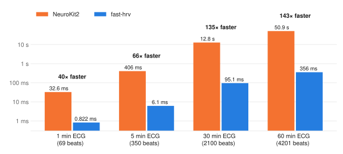

# fast_hrv

Heart rate variability (HRV) from ECG: R-peak detection, artifact handling and HRV metrics, with results
that match NeuroKit2 where the methods are the same, at a fraction of the time.

<picture>
  <source media="(prefers-color-scheme: dark)" srcset="fast_hrv_rs/docs/img/speed-dark.svg">
  
</picture>

<sub>Cleaning, R peaks, Kubios correction and all HRV metrics on a 512 Hz synthetic ECG, one thread,
NeuroKit2 0.3.0 vs the Rust crate 0.9.1 (Intel i7-9700K). Same R peaks; RMSSD, SDNN and SampEn equal to
&lt; 1e-14. Reproduce: `OMP_NUM_THREADS=1 python fast_hrv_rs/tools/neurokit_benchmark.py --minutes 1 5 30 60`.</sub>

## Three ways to use it

| Package | For | Install |
|---|---|---|
| **[`fast-hrv`](fast_hrv_rs/README.md)** (Rust crate in `fast_hrv_rs/`) | the full library: streaming, signal quality, artifact exclusion, per-window report, breathing and motion context | `cargo add fast-hrv --git https://github.com/omrylcn/fast_hrv` |
| **`fast_hrv_rs`** (Python binding of the crate) | the classic pipeline from Python at Rust speed | `cd fast_hrv_rs && maturin develop --release --features python` |
| **`fast_hrv`** (pure Python, `fast_hrv/`) | NumPy code that is easy to read and change; an optional Numba version | `uv pip install numpy scipy neurokit2` (+ `numba`) |

The Rust crate is where new work happens; its README describes the whole pipeline:
**[fast_hrv_rs/README.md](fast_hrv_rs/README.md)**.

## Quick start

Rust:

```rust
use fast_hrv::*;

let result = process_ecg(&ecg_signal, 512, true);          // clean, R peaks, Kubios correction
let report = hrv(&rri_from_peaks(&result.rpeaks, 512));    // 54 metrics
println!("RMSSD {:.1} ms  SDNN {:.1} ms", report.time.rmssd, report.time.sdnn);
```

Python, through the Rust binding:

```python
import numpy as np
import fast_hrv_rs

result = fast_hrv_rs.process_ecg(ecg_signal, 512, True)
print(len(result["rpeaks"]), result["stats"]["rmssd_ms"])

metrics = fast_hrv_rs.hrv_metrics(np.array([800.0, 810.0, 795.0, 805.0]))  # from RR intervals (ms)
```

Pure Python:

```python
from fast_hrv.ecg import process_ecg          # or fast_hrv.ecg_numba (first call compiles)

result = process_ecg(ecg_signal, sampling_rate=512, correct_artifacts=True)
print(result["stats"]["rmssd_ms"])
```

## What is in the Rust crate

- **Cleaning**: NeuroKit2-identical zero-phase filtering, and a causal filter for live data whose
  packet-by-packet output equals the whole-record output bit for bit.
- **R peaks**: NeuroKit2 and Elgendi detectors, sub-sample refinement, a choice of fiducial point that keeps
  wide QRS complexes stable, and a streaming detector that returns exactly the batch result.
- **Artifacts**: Kubios correction with a record of every changed beat, or an exclusion mode that leaves
  ectopic beats in place and drops the intervals around them.
- **Metrics**: time domain, frequency domain (Welch, Lomb–Scargle, NeuroKit2-compatible), Poincaré,
  entropy, DFA, asymmetry, fragmentation; smoothness-priors detrending; named presets with a provenance
  record.
- **Context**: signal quality indices, breathing rate from the ECG, accelerometer activity and posture.
- **Window rules**: each metric's minimum and recommended window length, and a per-window verdict
  (valid / warning / suppressed) with the reasons.

## Accuracy

Agreement with NeuroKit2 on the same input is tested in CI (`fast_hrv_rs/tests/`). On annotated real ECG
(MIT-BIH Arrhythmia, 18 records), the live detector's median RMSSD error is 0.7 % against the annotated
beats with the default fiducial point and 0.4 % with the adaptive one. Validation against a reference device
in the field is not claimed yet. Details: [fast_hrv_rs/docs/accuracy.md](fast_hrv_rs/docs/accuracy.md).

## Repository layout

```text
fast_hrv/          pure Python package (NumPy, Numba)
fast_hrv_rs/       Rust crate `fast-hrv` (+ PyO3 binding `fast_hrv_rs`)
  src/             library
  tests/           parity and equivalence tests (synthetic signals)
  tools/           reference generators, NeuroKit2 benchmark, MIT-BIH timing
  docs/            detailed documentation and README figures
```

## Tests

```bash
cd fast_hrv_rs
cargo test --release                      # NeuroKit2 / SciPy parity, stream = batch, …

# Python binding: build the wheel, install it, run the smoke test outside the repository
maturin build --release --out dist && pip install dist/*.whl
(cd /tmp && python "$OLDPWD/tests/python/smoke.py")
```

## Roadmap

- [x] Frequency domain (Welch, Lomb–Scargle, NeuroKit2-compatible)
- [x] Streaming mode, bit-identical to batch
- [x] Per-window verdicts, presets with provenance, breathing and motion context
- [ ] Validation against a reference device
- [ ] Published packages (crates.io, PyPI) and pre-built wheels

## References

- Makowski et al. (2021). NeuroKit2: A Python toolbox for neurophysiological signal processing.
- Lipponen & Tarvainen (2019). A robust algorithm for heart rate variability time series artefact correction.
- Task Force (1996). Heart rate variability: standards of measurement, physiological interpretation and clinical use.
- Tarvainen et al. (2002). An advanced detrending method with application to HRV analysis.
- Shaffer & Ginsberg (2017). An overview of heart rate variability metrics and norms.
- Moody & Mark (2001). The impact of the MIT-BIH Arrhythmia Database. PhysioNet.

## License

The Rust crate is licensed under MIT or Apache-2.0 at your option ([fast_hrv_rs/LICENSE-MIT](fast_hrv_rs/LICENSE-MIT), [fast_hrv_rs/LICENSE-APACHE](fast_hrv_rs/LICENSE-APACHE)).
