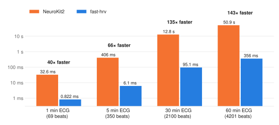
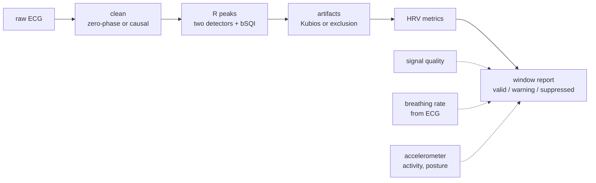

# fast-hrv

Heart rate variability (HRV) from ECG, in Rust: from the raw signal to R peaks, artifact handling and
54 HRV metrics, offline or packet by packet, with results that match NeuroKit2 where the methods are the
same.

<picture>
  <source media="(prefers-color-scheme: dark)" srcset="docs/img/speed-dark.svg">
  
</picture>

<sub>Cleaning, R peaks, Kubios correction and all HRV metrics on a 512 Hz synthetic ECG, one thread,
NeuroKit2 0.3.0 vs fast-hrv 0.9.1, Intel i7-9700K. Same R peaks, RMSSD/SDNN/SampEn equal to &lt; 1e-14.
Reproduce with `tools/neurokit_benchmark.py`.</sub>

## What it does



| Stage | In short | Details |
|---|---|---|
| Cleaning | NeuroKit2-identical zero-phase filter, or a causal streaming filter (optional notch) whose packet-by-packet output equals the whole-record output bit for bit | [detection.md](docs/detection.md) |
| R peaks | NeuroKit2 and Elgendi detectors, sub-sample refinement, choice of fiducial point, windowed processing of long records, a streaming detector with the batch output | [detection.md](docs/detection.md) |
| Signal quality | flat line, saturation, kSQI, pSQI, basSQI, bSQI, template correlation, RR plausibility | `sqi` module |
| Artifacts | Kubios correction (NeuroKit2-identical) with a per-beat record of what changed, or an exclusion mode that drops intervals around ectopic beats instead of moving them; gap-aware segments | [artifacts.md](docs/artifacts.md) |
| Metrics | time domain, frequency domain (Welch, Lomb–Scargle, NeuroKit2-compatible), Poincaré, entropy, DFA, asymmetry, fragmentation; smoothness-priors detrending | [metrics.md](docs/metrics.md) |
| Context | breathing rate from ECG and an HF band centred on it, accelerometer activity and posture | [metrics.md](docs/metrics.md) |
| Window rules | minimum and recommended length for every metric, and a per-window verdict with reasons | [metrics.md](docs/metrics.md#per-window-report-what-may-be-shown) |

Plain scalar `f64` code with no heavy dependencies: filters, FFT and splines are part of the crate, and nothing
assumes a particular CPU (no AVX, no `target-cpu=native`).

## Quick start

From R-peak sample indices:

```rust
let rri = fast_hrv::rri_from_peaks(&peaks, 512);   // R-peak indices → NN intervals (ms)
let r = fast_hrv::hrv(&rri);
println!("SDNN {:.1} ms  RMSSD {:.1} ms  LF/HF {:.2}  SampEn {:.2}",
         r.time.sdnn, r.time.rmssd, r.frequency.lf_hf, r.nonlinear.sampen);
```

From raw ECG, with sub-sample peaks and artifact correction:

```rust
use fast_hrv::detect::{ElgendiConfig, RefineConfig, elgendi_peaks, refine_peaks};
let clean = fast_hrv::ecg_clean_zero_phase(&raw, 512.0, &fast_hrv::EcgFilterConfig::default())?;
let cand = elgendi_peaks(&clean, 512.0, &ElgendiConfig::default())?;
let peaks = refine_peaks(&clean, 512.0, &cand, &RefineConfig::default())?;
let fixed = peaks.fix_kubios(512.0, &fast_hrv::KubiosParams::default())?;
let r = fast_hrv::hrv(&fixed.rri_ms(512.0));
```

Live, 32 samples at a time (the peaks equal the batch result bit for bit):

```rust
use fast_hrv::stream::{StreamConfig, StreamDetector, StreamPeaks};
let mut filt = fast_hrv::EcgStreamFilter::new(512.0, &fast_hrv::EcgFilterConfig::default())?;
let mut det = StreamDetector::new(512.0, 0, StreamConfig::default())?;
let mut out = StreamPeaks::default();
for packet in packets {
    det.push(&filt.process(packet), &mut out)?;   // out.primary: confirmed peaks
}
det.flush(&mut out)?;
```

A runnable version with gaps is in [`examples/streaming.rs`](examples/streaming.rs).

## Which numbers can be shown

A metric computed on a window is not automatically meaningful: the window may be too short for it, too
many beats may have been corrected, or slow breathing may have moved the respiratory peak into the LF band.
`window_report_rri` gives each metric a verdict and the reasons
([`examples/window_report.rs`](examples/window_report.rs), 60 s, two corrected beats in a row, breathing 7 /min):

```text
window 60 s, artifact ratio 2.8 %
mean_hr     70.79  valid
rmssd       19.41  warning    consecutive_corrections
sdnn        31.97  valid
hf           2.90  warning    below_strict_length, breathing_in_lf_band
lf_hf         NaN  suppressed not_computed, too_short, breathing_in_lf_band
sampen       0.18  suppressed too_short
```

The length limits come from the metric catalogue (`METRICS`, `metric_info("lf_hf")`), with their sources.
`hrv_with_preset(rri, Preset::KubiosLike)` runs a named set of processing choices and returns a
`Provenance` record (library version, preset, detrending, frequency method, intervals used) to store next to
the values.

## Accuracy

- **Against NeuroKit2** (same input): cleaning, R peaks, Kubios correction, time-domain and nonlinear
  metrics are identical to ≤ 3.3e-14 relative; `frequency_domain_neurokit` reproduces `nk.hrv_frequency` LF/HF
  to ≤ 3e-13. The default frequency method follows Task Force / Kubios practice and differs from NeuroKit2 by
  a few percent. Full table: [accuracy.md](docs/accuracy.md).
- **On annotated real ECG** (MIT-BIH Arrhythmia, 18 records, live path): median RMSSD error 0.7 % against
  the annotated beats with the default fiducial, 0.4 % with `Fiducial::ADAPTIVE`, which fixes the large
  errors on bundle branch blocks ([detection.md](docs/detection.md#fiducial-point-which-point-of-the-qrs-is-reported)).
- **Not claimed:** agreement with a reference device (chest strap, Holter) in the field. Matching NeuroKit2
  shows the methods are implemented as specified, not that a wearable recording is measured correctly.

`cargo test --release` runs 215 tests, including the NeuroKit2 and SciPy parity checks and stream = batch
equivalence for any packet size.

## Python

The `python` feature builds a PyO3 module (`maturin develop --release --features python`, then
`import fast_hrv_rs`) with `process_ecg`, `ecg_clean`, `find_peaks`, `fix_peaks`, `compute_quality`,
`hrv_metrics` and single-metric functions. It covers the classic pipeline; the streaming, exclusion,
window-report and context APIs are Rust-only for now.

## Features and toolchain

| Feature | Effect |
|---|---|
| `serde` | `Serialize`/`Deserialize` for report structs |
| `python` | PyO3 module `fast_hrv_rs` |
| `simd` | portable unrolled helpers; no CPU-specific instructions; off by default |
| `parallel` | reserved, currently no effect |

Rust 1.100.0 (`rust-toolchain.toml`), MSRV 1.85, edition 2024. Changes: [CHANGELOG.md](CHANGELOG.md).
Capacity estimate for a live multi-user pipeline: [CAPACITY.md](CAPACITY.md) (Turkish).

## License

Licensed under either of [MIT](LICENSE-MIT) or [Apache-2.0](LICENSE-APACHE) at your option.
