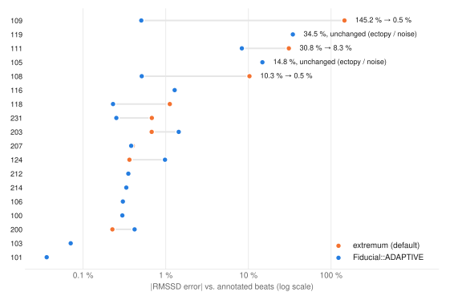

# ECG cleaning, R-peak detection and streaming

[← README](../README.md)

## ECG cleaning

| Function | Use | What it does |
|---|---|---|
| `ecg_clean`, `ecg_clean_neurokit` | offline | `nk.ecg_clean(method="neurokit")`: 0.5 Hz high-pass Butterworth order 5, zero-phase (`sosfiltfilt` with SciPy's padding), then NeuroKit's powerline moving average of `int(fs/50)` samples (`filtfilt`) |
| `EcgStreamFilter`, `ecg_clean_causal` | live / offline | causal 0.5 Hz high-pass (order 2) + 40 Hz low-pass (order 4), optional notch (`EcgFilterConfig::with_notch(50.0, q)`); state carried across packets |
| `ecg_clean_zero_phase` | offline | the same configurable band, zero-phase with SciPy-style padding |
| `filter::{butter_sos, iirnotch, sosfilt, sosfiltfilt, filtfilt_ba, SosFilter}` | building blocks | SciPy `butter(..., output="sos")`, `iirnotch`, `sosfilt`, `sosfiltfilt`, `filtfilt` |

Live and offline processing give the same result: feeding a signal to `EcgStreamFilter` in packets of any
size (e.g. 32 samples) is **bit-identical** to `ecg_clean_causal` on the whole signal (`tests/streaming.rs`).

```rust
use fast_hrv::ecg::{EcgFilterConfig, EcgStreamFilter};
let mut f = EcgStreamFilter::new(512.0, &EcgFilterConfig::default().with_notch(50.0, 30.0))?;
for packet in packets { let clean = f.process(packet); /* … */ }
```

## R-peak detection

| Function | What it does |
|---|---|
| `find_peaks_default` | NeuroKit2's default `neurokit` method (smoothed gradient, QRS regions, 0.3 s minimum delay) |
| `detect::elgendi_peaks` + `ElgendiConfig` | Elgendi two-moving-average detector: 8–20 Hz Butterworth (order 2, causal as NeuroKit2), squared signal, 97 ms / 611 ms moving averages, threshold offset β = 0.08 · mean, minimum block = QRS window (Elgendi 2013), 0.3 s refractory. Presets `ElgendiConfig::neurokit2013()` / `neurokit2010()` reproduce NeuroKit2's `elgendi2013` / `elgendi2010` exactly |
| `detect::refine_peaks` + `RefineConfig` | moves candidate peaks (any detector) to the R extremum of the clean signal within ±50 ms (configurable), polarity `Auto` (one sign per window, majority vote), `Positive`, `Negative` or `Absolute`; 3-point parabolic interpolation gives sub-sample positions |
| `rri_from_positions`, `rri_from_times` | RR intervals (ms) from sub-sample positions or times in seconds (the integer `rri_from_peaks` is unchanged) |
| `detect::dual_detect` + `DualConfig` | primary (Elgendi + refinement) and secondary (NeuroKit2 method) peaks on the same window and their bSQI (tolerance 0.15 s by default, 0.05 s variant documented); results only, no gate |
| `detect::detect_windowed`, `elgendi_refined_windowed` + `WindowConfig` | long recordings in fixed windows (default 10 s + 2 s margin each side) anchored at absolute sample indices; the detector restarts in every window and overlap duplicates are removed deterministically, so the output does not depend on where the recording starts |
| `detect::dual_detect_windowed` | both detectors of `dual_detect` over a long recording in the same windows (primary and secondary positions, each de-duplicated) |
| `stream::StreamDetector` + `StreamConfig` | the windowed pipeline packet by packet (see below): same peaks as `elgendi_refined_windowed` / `dual_detect_windowed`, bit for bit |

The default Elgendi detector (causal 8–20 Hz filter) reports beats ~37 ms after the R peak; the
refinement removes this delay (synthetic signals with known R: every refined peak within 0.4 samples).
NeuroKit2's `elgendi2010` is ~80 ms late and needs a refinement window of at least 0.09 s.
Run long recordings through `detect_windowed`: the Elgendi offset (β · mean energy) is computed over the
analysed input, so a single pass over a long, artifact-laden recording can miss many beats.

```rust
use fast_hrv::detect::{DualConfig, RefineConfig, ElgendiConfig, dual_detect, elgendi_peaks, refine_peaks};
let clean = fast_hrv::ecg_clean_zero_phase(&raw, 512.0, &fast_hrv::EcgFilterConfig::default())?; // 0.5–40 Hz
let cand = elgendi_peaks(&clean, 512.0, &ElgendiConfig::default())?;
let r = refine_peaks(&clean, 512.0, &cand, &RefineConfig::default())?;
let rri = fast_hrv::rri_from_positions(&r.positions, 512.0);          // sub-sample RR (ms)
let d = dual_detect(&clean[..5120], 512.0, &DualConfig::default())?;   // one 10 s window
println!("bSQI {:?}", d.bsqi.map(|b| b.bsqi));
```

### Streaming detection

`StreamDetector` takes clean samples (e.g. from `EcgStreamFilter`) in packets of any size and processes
each 10 s window as soon as its 2 s right margin has arrived. It emits confirmed peaks (absolute sample
index + sub-sample position) of the primary detector and, by default, of the secondary detector. For a
segment starting at absolute index `s0`, the emitted peaks are **bit-identical** to
`elgendi_refined_windowed` / `dual_detect_windowed` on the same samples with `start_sample = s0`, for any
packetisation (tested with 1, 32, 33, 512, 7168 and random packet sizes, several start offsets, gaps and a
30 min run with artifacts: `tests/stream_detect.rs`).

- **Latency** (defaults): a peak is emitted 2.3–12 s after the R peak (window + margin; ~7 s on average);
  a peak in the last ~0.3 s of a window may be a duplicate of the next window's and waits for it, worst
  case window + margin + 2 · dedup ≈ 12.3 s (`max_latency_samples()`).
- **State**: one buffer of at most window + 2 · margin samples (14 s, 56 KiB at 512 Hz) plus pending peaks:
  `state_bytes()` = 59.9 KiB per stream at 512 Hz (500 streams ≈ 29 MiB), constant over time. The buffer
  is the chunk the detectors read; `push_with` gives each processed window (samples, its own detections,
  bSQI) to a callback, e.g. for signal quality on the core, so no second sample ring is needed.
- **Gaps**: `reset_at(next_index)` ends the segment (its last windows are processed with clipped chunks,
  as the batch path does at the end of a recording) and returns the `Gap` for `gaps::split_at_gaps`.
  `flush()` ends the recording.

```rust
use fast_hrv::stream::{StreamConfig, StreamDetector, StreamPeaks};
let mut filt = fast_hrv::EcgStreamFilter::new(512.0, &fast_hrv::EcgFilterConfig::default())?;
let mut det = StreamDetector::new(512.0, session_start_index, StreamConfig::default())?;
let mut out = StreamPeaks::default();
for packet in packets {                     // 32 raw samples
    det.push(&filt.process(packet), &mut out)?;
    // out.primary / out.secondary: confirmed peaks (index: u64, position: f64)
}
// A gap (connection lost, timestamps jump): close the segment and restart the filter state.
let gap = det.reset_at(det.next_index() + gap_samples, &mut out)?;
filt.reset();
// ... keep pushing packets of the next segment ...
det.flush(&mut out)?;
// RR per segment from sub-sample positions (never across `gap`):
let rri = fast_hrv::rri_from_positions(&positions_of_one_segment, 512.0);
```

A complete runnable version (two segments with a gap, a `push_with` callback, RR and RMSSD per segment)
is in [`examples/streaming.rs`](../examples/streaming.rs): `cargo run --release --example streaming`.

**Reprocessing history must use the same causal path** (`EcgStreamFilter`, reset at every gap, then
`StreamDetector` or `dual_detect_windowed` on that output) to reproduce the live peaks. Cleaning history
with the zero-phase filter shifts peaks by ~8–10 ms; on noisy real recordings 16–26 % of them then no
longer match the live peaks within 50 ms.

## Fiducial point (which point of the QRS is reported)

RR intervals are differences between fiducial points, so a point that jumps within the QRS from beat to
beat adds noise to every beat-to-beat metric. By default the refinement reports the extremum (R peak, or
the deepest point with negative polarity). On wide or notched complexes (bundle branch blocks) the
extremum can alternate between two nearly equal deflections.

`RefineConfig::fiducial` selects the point for windowed and streaming detection:

| `Fiducial` | Point |
|---|---|
| `Extremum` (default) | refined extremum, sub-sample |
| `Centroid { half_window_s }` | energy centroid of the QRS (`Σ t·x² / Σ x²`, median removed) over ± `half_window_s` around the extremum, re-centred once |
| `Adaptive { ratio, memory_windows, half_window_s }` / `Fiducial::ADAPTIVE` | centroid in windows whose median beat is ambiguous (two or more extremes ≥ `ratio` × the largest, ≥ 20 ms apart, within ±80 ms), extremum otherwise; majority of the last `memory_windows` windows of the segment |

The adaptive memory resets at gaps, so `StreamDetector` and the windowed batch functions stay bit-identical
(`tests/fiducial.rs`).

Measured on 18 MIT-BIH Arrhythmia records on the live path (causal filter, `StreamDetector`), against the
annotated beats ([`tools/mitdb_timing.py`](../tools/mitdb_timing.py), `--env FIDUCIAL=adaptive`):

<picture>
  <source media="(prefers-color-scheme: dark)" srcset="img/fiducial-dark.svg">
  
</picture>

| Fiducial | median \|RMSSD error\| | mean | worst |
|---|---|---|---|
| Extremum | 0.68 % | 13.4 % | 145 % (109, LBBB) |
| Adaptive | 0.42 % | 3.6 % | 34 % (119) |
| Centroid everywhere | 0.60 % | 4.1 % | 46 % (119) |

The adaptive point is at most 0.75 points worse than the extremum on records with narrow QRS. Records 119
and 105 do not change: their error comes from frequent ventricular ectopy and noise, not from the fiducial.
All live peaks are about 11–14 ms late through the causal filter (constant, so RR is unaffected); the
centroid adds up to ~15 ms on wide complexes, also constant. `Fiducial::Extremum` stays the default; switching
the default is a separate decision.
